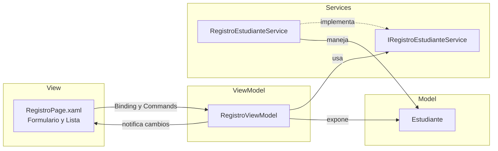

# RegistroEstudiantesApp

Aplicación desarrollada con **.NET MAUI** para registrar estudiantes y visualizarlos en una lista, aplicando el patrón de arquitectura **MVVM** (Model-View-ViewModel).

## Funcionalidades

- Formulario para registrar un estudiante.
- Lista de estudiantes registrados.
- Separación de responsabilidades mediante MVVM y una capa de servicios.

## Tecnologías

- .NET MAUI
- C# / XAML
- Patrón MVVM

## Estructura del proyecto

```
RegistroEstudiantesApp/
├── Models/
│   └── Estudiante.cs
├── Services/
│   ├── IRegistroEstudianteService.cs
│   └── RegistroEstudianteService.cs
├── ViewModels/
│   └── RegistroViewModel.cs
├── Views/
│   └── RegistroPage.xaml
├── App.xaml
├── AppShell.xaml
├── MainPage.xaml
└── MauiProgram.cs
```

## Arquitectura (MVVM)



### Descripción de las capas

| Capa | Archivo | Responsabilidad |
|------|---------|-----------------|
| **Model** | `Estudiante.cs` | Representa los datos de un estudiante. |
| **View** | `RegistroPage.xaml` | Interfaz con el formulario y la lista. No contiene lógica de negocio. |
| **ViewModel** | `RegistroViewModel.cs` | Expone propiedades y comandos a la vista mediante data binding. |
| **Services** | `IRegistroEstudianteService.cs`, `RegistroEstudianteService.cs` | Lógica de registro y consulta de estudiantes, desacoplada mediante una interfaz. |

## Capturas de pantalla


